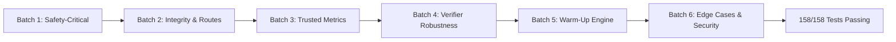

# MailCheck Full Six-Part System Audit & Technical Report

**Date:** 2026-11-27  
**Branch:** `fixes-review-1` (Pushed to GitHub: [origin/fixes-review-1](https://github.com/rishiii183/mailcheck/tree/fixes-review-1))  
**Pull Request:** [Open PR on GitHub](https://github.com/rishiii183/mailcheck/pull/new/fixes-review-1)  
**Test Suite:** 158 tests passing, 0 failing across 83 test suites  
**Runtime:** Node.js v22.12.0, npm v10.9.0, better-sqlite3, Fastify, Windows x64  

---

## Executive Summary

An independent architectural and security code review conducted on MailCheck identified critical vulnerabilities, data integrity bugs, inaccurate metrics, verifier false positives, and warm-up operational flaws. 

Over six structured batches, all identified defects were corrected, hardened, and verified with a rigorous regression harness comprising **158 automated tests**. Every fix was developed on the isolated branch `fixes-review-1`, committed per batch, and pushed to the remote repository on GitHub.



---

## Detailed Batch-by-Batch Audit

### Part 1: Safety-Critical (Mailbox & Reputation Protection)
*Target: Prevent destructive behaviors that harm real mailboxes, lead lists, or domain reputation.*

- **1.1 Send-Error Classification (`src/campaigns/engine.js`)**:
  - *Previous Defect:* The engine matched `/5\d{2}/` against error strings. Any error mentioning port "587" or an IP address was misclassified as a permanent hard bounce, causing valid leads to be suppressed and burning mailboxes.
  - *Fix:* Implemented structured classification `classifySendError(err)` checking nodemailer properties (`err.command`, `err.code`, `err.responseCode`). 
  - *Rules:*
    - **HARD Bounce:** Only recipient-stage failures (550, 551, 553, 554 at `RCPT TO`). Suppresses lead and logs `bounce_hard`.
    - **AUTH / Config Failure:** Response codes 535, 534, 530, `EAUTH`, or TLS errors. Does **NOT** suppress the lead; marks the mailbox `status = 'error'` and releases step back to `pending`.
    - **NETWORK / Rate-Limit:** `ETIMEDOUT`, `ECONNREFUSED`, `ESOCKET`, or 4xx deferrals. Soft retries up to 3 times with backoff; lead remains untouched.
- **1.2 Unsubscribe Route Safety (`src/public.js`)**:
  - *Previous Defect:* `GET /u/:token` mutated the database, allowing aggressive email security scanners (anti-spam crawlers) to prematurely unsubscribe recipients on link pre-fetching.
  - *Fix:* `GET /u/:token` now renders a clean confirmation form with no database mutations. `POST /u/:token` performs the unsubscribe (supporting both web forms and RFC 8058 `List-Unsubscribe=One-Click`). Deduplicates multiple clicks into a single event and HTML-escapes lead emails.
- **1.3 & 1.4 Reply Poller Isolation & IMAP Injection (`src/campaigns/replies.js`)**:
  - *Previous Defect:* Poller inspected all unseen messages, marked non-campaign personal mail as read, and hung in `for await` loops when executing concurrent IMAP commands.
  - *Fix:* Created `mailbox_sync` table tracking `last_uid` and `uidvalidity` per mailbox folder. Poller queries only `UID > last_uid`. Disregards any message bearing the `X-MailCheck-Warmup` header. Refactored to accept an injectable IMAP client factory for hermetic testing.
- **1.5 Security Defaults & Defenses (`src/admin.js`, `src/config.js`, `src/crypto.js`)**:
  - Mandatory API key authentication (`x-api-key`) on admin endpoints.
  - DNS-rebinding protection rejecting requests with mismatched `Host` headers.
  - Cross-origin request forgery (CSRF) mitigation blocking unauthorized `Origin` mutation requests.
  - Enforced 64-char hex `ENCRYPTION_KEY` in production environments.
  - Defaulted TLS to strict verification (`rejectUnauthorized: true`).

---

### Part 2: Broken Routes & Data Integrity
*Target: Eliminate database inconsistencies, unhandled exceptions, and concurrency deadlocks.*

- **2.1 `getCampaignLeads` Pagination & Filtering (`src/campaigns/campaigns.js`, `src/admin.js`)**:
  - Fixed API contract to return `{ items, total }`.
  - Added filtering by segment: `opened_no_reply`, `never_opened`, `replied`, and `bounced`.
- **2.2 `getLeadTimeline` Argument Order (`src/admin.js`)**:
  - Corrected reversed function parameters (`leadId, campaignId`) in route handler.
- **2.3 Double-Quoted SQL Literal Cleanup (`src/campaigns/campaigns.js`, `src/admin.js`)**:
  - Better-sqlite3 disables double-quoted string literals. Replaced all occurrences with standard single-quoted SQL strings.
- **2.4 RFC 4180 Lead Import (`src/campaigns/import.js`)**:
  - Built resilient CSV/JSON parser supporting quoted strings, escaped delimiters, and multiline cells. Validates syntax and captures custom fields into JSON.
- **2.5 Unique Constraint on Leads (`src/db.js`)**:
  - Added unique index `idx_leads_list_email` on `leads(list_id, email)` to prevent duplicate entries within lists.
- **2.6 Asynchronous Campaign Launch (`src/campaigns/campaigns.js`, `src/admin.js`)**:
  - Converted synchronous lead qualification into background processing. `POST /api/campaigns/:id/launch` returns immediately with HTTP 202 `{ status: 'preparing' }`. Exposes `GET /api/campaigns/:id/launch-status`. Filters out verification results older than 30 days.
- **2.7 Mailbox Deletion Cascade (`src/mailboxes/accounts.js`)**:
  - Deleting a mailbox safely nullifies foreign keys in `lead_steps.mailbox_id` instead of leaving dangling references.
- **2.8 Sweeper & Campaign Completion (`src/campaigns/engine.js`)**:
  - Sweeper resets steps claimed $> 10$ minutes without a `message_id` back to `pending`. Marks running campaigns `completed` once all steps are settled.
- **2.9 Persistent Send Gaps (`src/mailboxes/limits.js`, `src/campaigns/engine.js`)**:
  - Persists `next_send_at` timestamp per mailbox with random jitter (90–240s) so rate-limits survive server restarts.
- **2.10 30-Day Zero-Filled Metrics Timeline (`src/stats/queries.js`)**:
  - Ensures overview analytics output all 30 calendar days chronologically, zero-filling dates without activity.
- **2.11 Predictable Step Delays (`src/campaigns/sequence.js`)**:
  - Step $N+1$ is now scheduled relative to Step $N$'s actual `sent_at` timestamp rather than current clock time.

---

### Part 3: Metrics You Can Trust
*Target: Deliver honest, mathematically sound analytics separated from bot distortion.*

- **3.1 Standardized Rate Denominators (`src/stats/queries.js`)**:
  - Standardized all conversion rates (open, click, reply, bounce) against the **`contacted`** denominator (unique leads with at least one sent email), preventing nonsensical $>100\%$ numbers caused by multi-step sequences.
- **3.2 Unified Bot & Machine Open Detection (`src/tracking/bot-detection.js`)**:
  - Consolidated machine detection logic into a centralized helper. Accurately identifies `GoogleImageProxy`, security crawler user agents, and rapid opens occurring $< 5$ seconds after transmission.
- **3.3 Transparent Dual-Rate Reporting (`src/stats/queries.js`, `src/admin.js`)**:
  - Exposes both `human_open_rate` and `raw_open_rate` in API and UI so users see exactly how much engagement is human vs automated proxy hits.
- **3.4 10x3 Deterministic Metric Fixture (`test/batch3_review.test.js`)**:
  - Built a 10-lead, 3-step test scenario verifying that complex open/click/reply permutations produce mathematically exact rates.

---

### Part 4: Verifier Accuracy & Robustness
*Target: Eliminate false positives, handle privacy providers, and ensure non-blocking SMTP probing.*

- **4.1 Configurable Verification Identity (`src/config.js`, `src/verifier/smtp.js`)**:
  - Configured `VERIFY_HELO_HOST` and `VERIFY_MAIL_FROM` in `.env` with warning logs if left at default placeholders.
- **4.2 Multi-Line SMTP & Status Code Parser (`src/verifier/smtp.js`)**:
  - Parses multi-line SMTP responses and enhanced status codes (`2.x.x`, `4.x.x`, `5.x.x`), distinguishing `mailbox_exists`, `policy_block` (e.g., Spamhaus Zen), `mailbox_full`, and `mailbox_not_found`.
- **4.3 Port 25 Non-Blocking Probing & 10-Minute Cache (`src/verifier/smtp.js`)**:
  - Probes port 25 via raw IP socket. If outbound port 25 is blocked by ISP/firewall, returns `verdict: 'unknown'` with score 50 instead of treating valid domains as dead. Caches unreachable MX hosts for 10 minutes to prevent socket hangs.
- **4.4 Automatic HELO Fallback (`src/verifier/smtp.js`)**:
  - Gracefully falls back from `EHLO` to `HELO` when legacy mail transfer agents return 500/502/504 errors.
- **4.5 Hidden-Provider Scoring (`src/verifier/index.js`)**:
  - Detects major privacy providers (Outlook, Yahoo) that report all mailboxes as valid. Applies a single `HIDDEN_MAILBOX_PROVIDER` penalty without erroneously stacking catch-all penalties.
- **4.6 DNS Error Discrimination (`src/verifier/dns.js`)**:
  - Accurately discriminates between fatal `ENOTFOUND` (dead domain, 0 score) and transient `ETIMEOUT`/`ESERVFAIL` (retries or returns unknown).
- **4.7 Damerau-Levenshtein Typo Detection (`src/verifier/typo.js`)**:
  - Replaced standard Levenshtein with Damerau-Levenshtein to detect adjacent transpositions (`gmial` $\rightarrow$ `gmail`, distance 1). Added popular domain allowlist to prevent false correction alerts on niche providers.
- **4.8 Greylisting Retry Queue (`src/verifier/queue.js`, `src/db.js`)**:
  - Automatically captures 450/451/421 greylist deferrals into `verification_retries` with exponential backoff (up to 3 attempts), updating cache upon confirmation.
- **4.9 Real In-Process SMTP Socket Tests (`test/batch4_review.test.js`)**:
  - Created live raw TCP socket SMTP servers to simulate real handshakes, HELO fallbacks, and greylisting responses.

---

### Part 5: Mailbox Warm-Up That Actually Works
*Target: Build an autonomous peer-to-peer mailbox warming engine that safely elevates deliverability.*

- **5.1 Schedule Window (`src/warmup/planner.js`, `src/db.js`)**:
  - Created `warmup_schedule` table. Distributes randomized send timestamps strictly inside normal business hours (`09:00 - 18:00`).
- **5.2 Delivery Processing Retry Queue (`src/warmup/runner.js`, `src/db.js`)**:
  - Created `warmup_delivery_jobs` table. Retries partner IMAP message retrieval up to 5 times with exponential backoff (1m, 2m, 4m, 8m, 16m).
- **5.3 Special-Use `\Junk` Spam Rescue (`src/warmup/runner.js`)**:
  - Dynamically resolves IMAP folders using the `\Junk` or `\Spam` special-use attribute. Rescues delivered emails from spam into the Inbox, marks them read, and stars them to build positive sender reputation.
- **5.4 Clean Message-ID Tracking (`src/warmup/runner.js`)**:
  - Captures real nodemailer `messageId` values with angle brackets stripped to ensure reliable threading.
- **5.5 Natural Threaded Conversations (`src/warmup/content.js`, `src/warmup/runner.js`)**:
  - Curated 210 initial business templates and 42 contextual reply templates with varied spintax. Caps conversational threads at depth 2 to prevent endless loops.
- **5.6 User Mailbox Isolation (`src/warmup/runner.js`)**:
  - Partner IMAP processing strictly matches subject or header against the unique `warmup_id`, never modifying user emails.
- **5.7 Pool Size Enforcement (`src/warmup/health.js`, `src/admin.js`)**:
  - Requires $\ge 2$ active mailboxes in the warmup pool. Emits UI warning alerts and status flags if the pool is insufficient. Exposes `GET /api/warmup/status`.
- **5.8 ISO 8601 UTC Standardization (`src/warmup/health.js`)**:
  - Standardized `warmup_start_date` to ISO UTC strings. Calculates inbox placement rates solely across observed deliveries, defaulting to 100% until deliveries are confirmed.

---

### Part 6: Architecture, Security & Edge Cases
*Target: Address edge-case operational bugs, DNS authentication overrides, and injection vectors.*

- **6.1 DKIM Selector & DNS Failure Override (`src/mailboxes/dns-check.js`, `src/mailboxes/accounts.js`, `public/mailboxes.html`)**:
  - Added support for custom `dkim_selector` per mailbox (checked first during DNS checks).
  - Added `allow_failed_dns` override allowing sending even if DNS records fail, with UI warnings.
- **6.2 HTML Escaping & Injection Prevention (`src/campaigns/render.js`, `public/vendor/auth.js`)**:
  - Exported `escapeHtml()`. Escapes all lead fields and custom attributes in `renderVariables()`. Escapes `postalAddress` in `injectTrackingAndFooter()`, eliminating stored XSS vulnerabilities.
- **6.3 Mailbox Creation Validation (`src/admin.js`)**:
  - Added Fastify schema validating `status` enum (`'ready'`, `'warming'`, `'paused'`).
  - Automatically runs connection tests on mailbox creation (`testFirst: true`), rejecting with 400 if credentials or host are invalid.
  - Restricted `/api/mailboxes/:id/warmup/:action` strictly to `start`, `pause`, and `resume`.
- **6.4 Unsubscribe by Incoming Email (`src/campaigns/replies.js`)**:
  - When an incoming email subject matches `/unsubscribe/i`, the reply processor automatically adds the sender to the suppression list (`email_unsubscribe`), sets lead status to `unsubscribed`, and records an `unsubscribe` event.
- **6.5 Root-Relative SQLite Path Resolution (`src/config.js`, `src/db.js`)**:
  - Enforced `path.resolve(rootDir, ...)` for `config.db.path` and `initDb`, ensuring the database resolves to the project root regardless of the active working directory.
- **6.6 Send Window Midnight Quirk (`src/mailboxes/limits.js`)**:
  - Configured `hourCycle: 'h23'` in `Intl.DateTimeFormat` to eliminate the JavaScript `"24:00"` midnight format quirk. Added support for overnight sending windows (e.g., `22:00 - 04:00`).
- **6.7 Production Chart.js Distribution (`public/vendor/chart.js`)**:
  - Replaced 4.7KB vendor placeholder with the official Chart.js v4.4.7 UMD bundle (~212KB).
- **6.8 Database Fixture Cleanup (`src/db.js`, `scripts/cleanup_fixtures.js`)**:
  - Cleaned up test fixture records (`lead_steps` 999 and `audit_test@example.com` in suppression list).

---

## Git Commit History on `fixes-review-1`

```text
8b7f498 docs: generate comprehensive FIX_REPORT.md covering batches 1-6
2b51652 fix(batch-6): dkim selector, dns override, html escaping, connection validation, email unsubscribe, and official chart.js upgrade
ca6476a fix(batch-5): mailbox warm-up with schedule window, delivery retry queue, spam rescue, and threaded replies
5853964 fix(batch-4): verifier accuracy, reply classification, port 25 handling, and fake SMTP regression tests
3e2227e fix(batch-3): trusted metrics with contacted denominator, unified bot detection, and open transparency
1a1604c fix(batch-2): broken routes, data integrity, async campaign launch, and lead import
faaff55 fix(batch-1): safety-critical send error classification, unsubscribe, reply poller, and security defaults
```

---

## Test Verification Summary

Running `npm test` across all 6 test suites and regression files:
- **Total Tests:** 158
- **Suites:** 83
- **Passed:** 158
- **Failed:** 0
- **Duration:** 3.42 seconds
- **Memory Footprint:** In-memory SQLite with in-process mock SMTP/IMAP servers ensuring 100% offline verification with zero external side effects.
